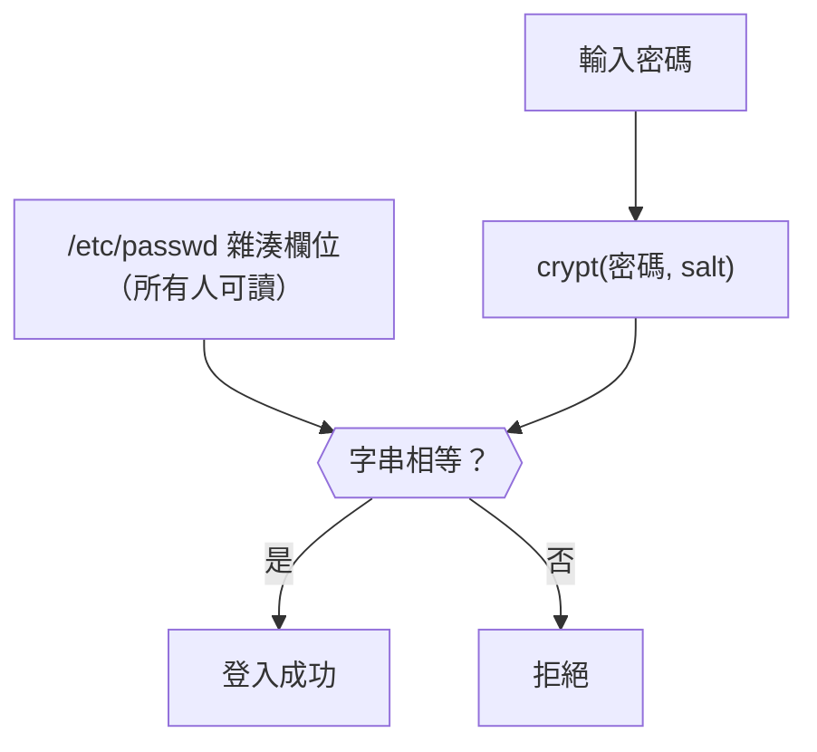
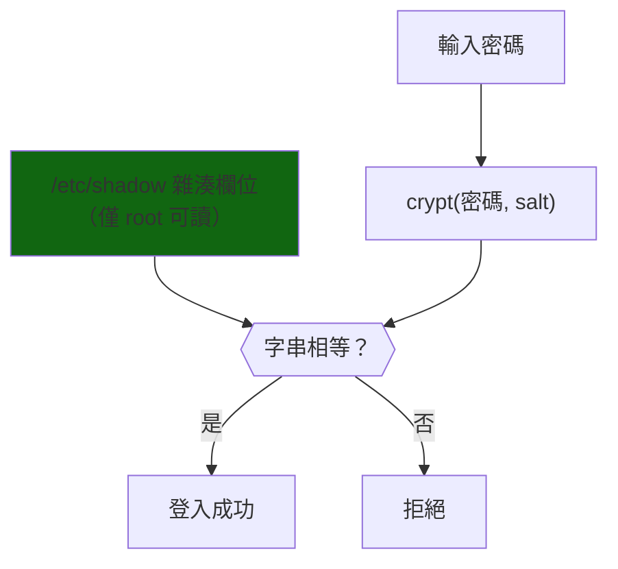
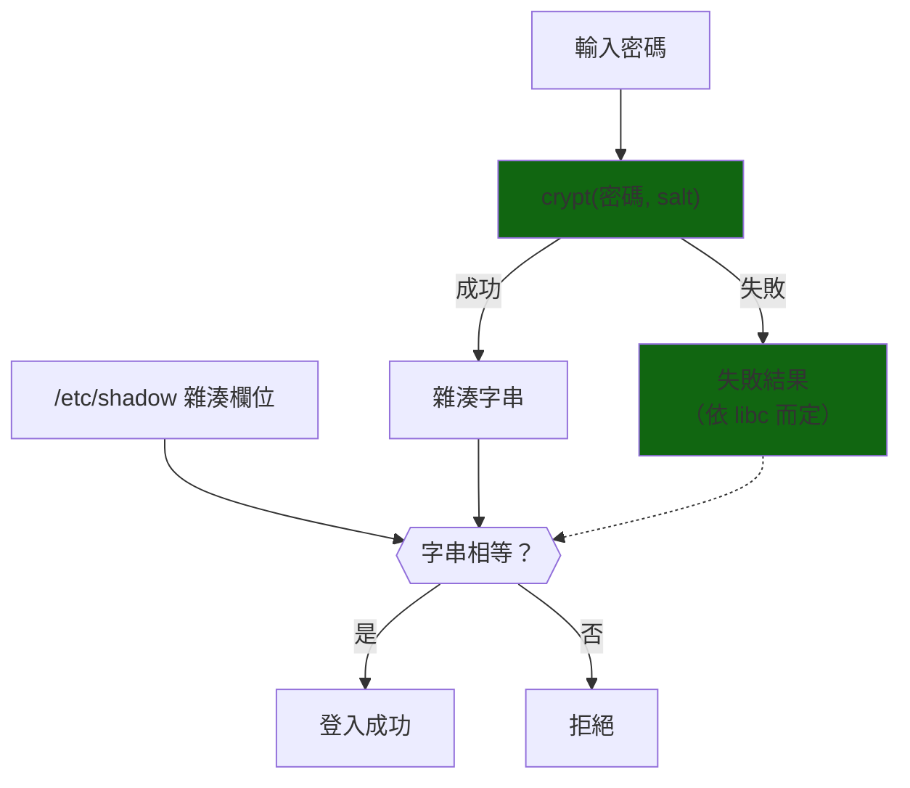

# sshhole 的因緣巧合

---

# sshhole

在特定 Linux 設定下，原本禁止使用密碼登入的帳號，可能被 OpenSSH 誤判為驗證成功。
- 影響範圍 : 使用 musl libc 的 OpenSSH 伺服器，在未使用 PAM（可插拔驗證模組）且啟用密碼登入時，可能受影響。
- 漏洞成因 : musl 的 crypt() 在雜湊失敗時可能回傳 `*`，而 `*` 也用來標記禁止密碼登入的帳號。OpenSSH 直接比對兩者，可能把失敗結果當成密碼吻合。
- 安全影響 : 攻擊者可能在不知道有效密碼的情況下登入受影響帳號。若該帳號具備提權權限，攻擊者可能進一步取得 root（系統管理員）權限。

---
layout: two-cols
---

# Unix 密碼驗證流程

登入是怎麼運作的？

**1980** : 你的密碼會以條列式存放到 `/etc/passwd`，任何人都可以讀取到，`*` 代表沒有任何人可以利用密碼登入的帳號，因為 `*` 不屬於雜湊值。

```text
alice:Xq3rT9kz1Y2aB:1000:1000::/home/alice:/bin/sh
daemon:*:1:1::/usr/sbin:/bin/sh
```

- 系統不存明文，只存 `crypt(密碼, salt)` 的結果
- 登入時把輸入的密碼再算一次，**字串相等就放行**

::right::



---
layout: two-cols
---

# Unix 密碼驗證流程

雜湊誰都看得到，就能拿回家慢慢猜

**1980 年代末** : 出現 shadow password（影子密碼）。

- 雜湊搬到 `/etc/shadow`，只有 root 可讀
- `/etc/passwd` 的密碼欄位改填 `x`，代表「去 shadow 找」
- `*`、`!` 這類「禁止密碼登入」的標記一起搬過去

```text
# /etc/shadow
alice:Xq3rT9kz1Y2aB:19700:0:99999:7:::
daemon:*:19700:0:99999:7:::
```

比對邏輯**完全沒變**，只是換了存放位置。

::right::



---
layout: two-cols
---

# Unix 密碼驗證流程

DES 不夠用了，演算法開始變多

`crypt()` 依照 salt 的前綴決定要用哪個演算法：

- 無前綴 → DES
- `$1$` → MD5
- `$5$` / `$6$` → SHA-256 / SHA-512

那遇到**看不懂的 salt** 呢？例如 `*`？

- `crypt()` 會失敗
- 但「失敗要回傳什麼」，各家 libc 的做法不一樣
- 有的回傳 `NULL`，有的回傳一個**字串**

::right::



---

# musl 的多輪修改

crypt 函數的演進

- 1990 : `crypt()` 任何無法處理的內容，失敗回傳 `NULL`。但絕大多數程式中不直接檢查 `NULL`，而是直接把回傳值拿去比對字串，如果遇到 `NULL` 程式直接崩潰。

<v-click>

- 2012 : 為了避免程式崩潰，musl 改成失敗回傳 `*`。

</v-click>

<v-click>

- 2012 三週後 : 因為 sha512 的加入，密碼越長雜湊時間也隨之加長，有人刻意利用這個特性來阻塞伺服器，因此之後限制密碼最大長度為 256 字元。

</v-click>


<v-click>

- 2016 : CVE-2016-6210，對 sshd 查詢一個不存在的用戶會立即回傳否，所以可以利用回傳時間判斷有使用者有沒有存在，修復的方式是隨便選一個帳號的 salt 走個流程，透過模擬雜湊縮小回應時間差，防止帳號枚舉。

</v-click>

<v-click>

> Timing equalization（回應時間均衡化）: 它是用來緩解 Timing side channel（時間側通道） 的手段。
> 
> Constant-time comparison（常數時間比對）是在比對兩段固定長度的資料時，即使發現不同，也會處理完所有位元組才回傳結果。這樣一來，比對耗時就不會因為第一個不同的位置而改變，避免洩漏前面有多少內容相符。常用於比對 HMAC（雜湊式訊息驗證碼）等敏感資料。

</v-click>

---

# alpine docker image

[CVE-2019-5021](https://www.ithome.com.tw/news/130528) 反反覆覆的修補

- 2019 : 因為 alpine docker image 被發現沒有設定 root 密碼，所以用了 `!` 來代替，但 `!` 會導致 ssh key 登入失效

<v-click>

- 2022 : alpine 最終將 root 密碼欄位改成 `*`。

</v-click>

---

# 兩者最終的交會

陰錯陽差之下產生的漏洞

因為 musl 的 crypt() 會在雜湊失敗時回傳 `*`，而 alpine 也把 `*` 當作禁止密碼登入的標記，因此在特定情況下，OpenSSH 可能會誤判密碼驗證成功。

<v-click>

最終，OpenSSH 作法是判定帳號儲存的密碼欄位如果短到不可能是有效雜湊，例如只有一個 `*`，`sshd` 就會判定密碼驗證失敗。即使 musl 的 `crypt()` 也回傳 `*`，兩個字串相等也不會放行。

</v-click>

---
layout: center
---

# Thank you
